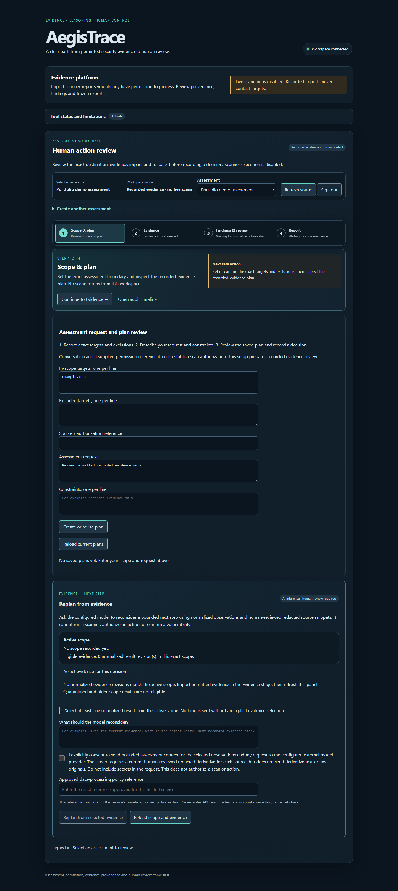
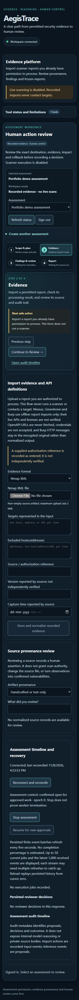

# Guided analyst workspace

The authenticated analyst workspace is organized into four stages that can be revisited without discarding the currently mounted forms:

1. **Scope & plan** — review exact scope, recorded-evidence plan, and evidence-driven recommendation.
2. **Evidence** — import an existing permitted report, read its normalized/quarantined result, review source provenance, and inspect the audit timeline.
3. **Findings & review** — inspect action-bound approvals, record analyst context, review duplicate suggestions, and write evidence-linked findings.
4. **Report** — choose executive or analyst presentation, inspect coverage and unknowns, and freeze a point-in-time PDF.

The stage bar identifies the active assessment and its recorded-evidence mode. Each stage has a primary shortcut to the form or review panel relevant to its current state. The shortcut moves keyboard focus to the destination. The Evidence stage also links directly to replanning. Tool capabilities and the audit timeline are available from every stage.

The import form separates the original file, its represented targets and exclusions, and its capture metadata. The processing summary shows the outcome and reason, with technical output available on demand. A successful import links to provenance review. In Findings & review, select a source observation to inspect its original reference and hash before saving. The Report stage separates presentation mode from PDF export, shows the frozen export ID, and groups recorded workflow checks separately from live execution and lab checks.

For recordings covered by the same assessment authorization, use the same exact targets, exclusions, and authorization reference. The import form reuses the current matching recorded scope if it has no expiry. Each file still has its own run, capture time and digest. Changed boundaries create a new revision. Earlier imports stay on the scope where they were recorded.

Changing stages preserves drafts. Switching to another assessment clears the import draft and loads that assessment's own data. A failed coverage request shows a recovery action, and a permission error or expired session gets its own message.

When a new report includes sources from more than one scope revision, its PDF lists each selected scope and identifies the revision for every source run. The assessment-wide coverage section describes the wider workspace at export time. Existing frozen exports retain their original layout.

## Automated UI walkthrough

From `frontend/`:

```powershell
npm run build
npm run check:workspace
npm run check:replan
node scripts/check-accessibility-ui.mjs
```

`check:workspace` uses synthetic API fixtures to verify stage navigation, focus at shortcut destinations, coverage recovery, draft preservation within an assessment, draft isolation between assessments, and narrow layout. The accessibility journey covers keyboard operation, action denial and PDF download, and runs axe checks in both presentation modes.

## Safe screenshots

The screenshots use a synthetic assessment with no imported files. Compare with the [previous desktop layout](https://github.com/tanmayskotadia/ai_agent_penetration_testing/blob/d81a093543e048be605c359d3318f53d18ec2e2f/docs/images/issue-107/workspace-desktop.png) and [previous mobile layout](https://github.com/tanmayskotadia/ai_agent_penetration_testing/blob/d81a093543e048be605c359d3318f53d18ec2e2f/docs/images/issue-107/workspace-mobile.png).





## Manual acceptance still required

A fresh reviewer should use a permitted assessment and complete the path without developer instructions: select an assessment, set scope, inspect a plan, import a permitted recorded report, review its source, trace a finding to evidence, and export a PDF. They should repeat stage navigation using only the keyboard and inspect the page at a narrow mobile width. Record their role (analyst or nontechnical reader), pass/fail for each step, confusing labels or blockers, and any follow-up fixes. Do not include credentials, private targets, original scanner output, or personal data in screenshots or notes.

Do not mark the UI issue accepted based only on synthetic screenshots or automated browser tests. Existing server-side authorization, provenance, approval, redaction, stale-state and audit controls remain authoritative; the UI must not imply otherwise.
