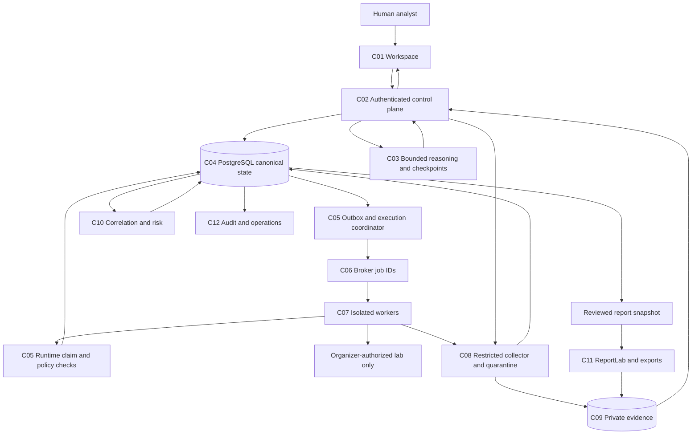

# AegisTrace technical architecture

**Decision baseline:** T02 / [issue #15](https://github.com/tanmayskotadia/ai_agent_penetration_testing/issues/15), 4 November 2026. This is an accepted implementation direction, not a claim of implemented scanner capabilities. The [requirements baseline](requirements.md), [threat model](threat-model.md), [decision records](adr/README.md), and [five design walkthroughs](architecture-walkthroughs.md) form one reviewable design.

## Outcome and implementation boundary

An analyst provides conversational intent and an organizer-authorized scope. The system proposes an evidence-grounded plan, executes approved supported scans/imports, preserves original outputs, correlates findings, prioritizes risk, obtains explicit human approval before offensive validation, and exports a source-traceable VAPT report. Distinct assets, uncertainty, failed scans and unsupported tools remain visible.

T02 defines component ownership, interactions and safety invariants. Runtime scaffolding belongs to T03; detailed schemas/adapters/policy/reasoning/reporting belong to their linked issues. No deployment, lab target, model endpoint, paid account or commercial entitlement is assumed available. The participant confirmed there is **no organizer lab authorization yet**; live execution is disabled until T04 obtains it.

## Component ownership

| ID | Component / implementation direction | Owns | Does not own | Downstream tasks |
|---|---|---|---|---|
| C01 | React + TypeScript workspace | Conversation, scope/plan review, timeline, finding/evidence views and explicit approval UI | Authorization authority or claims that an optimistic UI action executed | T49-T54 |
| C02 | FastAPI control plane | Authenticated resource APIs, revision checks, scope/approval policy, evidence/download authorization and progress events | Scanner subprocesses in web request threads | T10, T13, T15-T16 |
| C03 | LangGraph reasoning service | Bounded structured proposals, cited decision summaries and resumable review/checkpoints | Raw shell, self-approval, direct external scanner control or canonical finding truth | T37-T42 |
| C04 | PostgreSQL domain store | Assessments, scope/plan revisions, actors, grants, jobs, observations, occurrences, findings, audit/outbox and frozen report references | Raw artifact bytes or broker delivery guarantees | T07, T09, T19 |
| C05 | Outbox dispatcher / execution coordinator | Durable dispatch, runtime authorization, atomic attempt/grant claim, leases, external run identity and reconciliation | Choosing a new target outside reviewed scope | T19, T21, T23 |
| C06 | Redis + Celery broker/transport | Wake-up messages carrying job IDs and bounded execution scheduling | Sole job/result truth, authorization or exactly-once execution | T19, T21 |
| C07 | Isolated scanner workers | Restricted adapter templates, bounded tool execution, cancellation attempts and collection | Public Internet scanning, arbitrary executable/argument acceptance or database administration | T20, T25-T36 |
| C08 | Import/quarantine/normalization service | File validation, safe native parsing, scope association and immutable observations | Trusting scanner text as instructions or silently confirming a vulnerability | T11, T23, T35 |
| C09 | Private evidence storage | Original bytes, server-generated object IDs, hashes, sanitized derivatives and controlled retrieval | Public static hosting or uncontrolled deletion of referenced artifacts | T08 |
| C10 | Correlation / risk / intelligence service | Conservative clusters, preserved occurrences, uncertainty, supported identifiers and versioned priority factors | Fabricated proof/CVSS or unlabelled inferred attack paths | T40, T43-T48 |
| C11 | Report snapshot / ReportLab worker | Reviewed immutable report input, deterministic templates, PDF and structured exports | Arbitrary HTML/remote image execution or mutable reports after delivery | T55-T60 |
| C12 | Operations / audit / reconciliation | Attributable events, redacted diagnostics, health, recovery and retention/restore procedures | Secret-bearing analytics or an absolute tamper-proof guarantee | T09, T63-T66 |

Use one modular Python codebase with separately runnable API, reasoning, execution/ingestion and reporting processes. Split deployment/process permissions where trust requires it; avoid distributed microservices for every module. A single relational store is enough initially: typed evidence edges and ordinary indexes support the graph view without a separate graph/vector database. Introduce another store only after measured query or isolation needs justify it.

## Trust and deployment diagram

Arrows are permitted logical flows, not an instruction to grant unrestricted network access. There are separate control-plane, worker execution, evidence, external-model/intelligence and lab zones. For development use a Linux VM/container host when available; a Windows host alone is not proof of Linux worker isolation. Public cloud deployment and ingress are not needed for M01.

| Boundary | Permitted crossing | Enforced by implementation | Fail-closed behavior |
|---|---|---|---|
| B01 Browser to API | Authenticated resource requests; public health has no private data | Actor membership/role, input validation, CSRF/session rules where applicable | No private evidence/job/approval access without authorization |
| B02 Model to control plane | Typed proposals and cited concise rationale | Schema, capability and scope validators outside LLM | Reject unsupported output; evidence-only analyst review remains possible |
| B03 Coordinator to worker | Job-ID claim, short-lived action envelope, bounded collector access | Service identity, lease, scope/profile/grant revision checks | No execution if coordinator or approval cannot be verified |
| B04 Worker to target | Exact authorized lab destinations/profiles only | Runtime destination validation plus independent network egress restrictions | Deny unknown/excluded addresses, changed DNS/redirect escape and unapproved active actions |
| B05 Files to parsers | Bounded bytes in quarantine | Size/depth/time limits, entity-disabled XML, safe paths, format/version allowlist | Preserve quarantined original and diagnostic; no fabricated findings |
| B06 Control plane to model/intelligence endpoint | Approved sanitized fields to configured destination | Egress allowlist, redaction, provider/data policy and budget | Disabled by default without configuration/permission; no raw credentials |
| B07 Store to evidence/report consumer | Authorized original/derivative download | Assessment membership, server-generated object IDs, retention and hash checks | No public object listing or cross-assessment access |
| B08 Administration/backup to runtime | Explicit migration/restore/operation roles | Least privilege and separation from normal app/worker identities | No scanner access to Docker socket, host admin or general DB credentials |

Container network names alone do not establish B04. T04/T14 must verify actual host/VM routing, IPv4/IPv6, DNS, redirects and outbound denies. Prefer unprivileged TCP-connect discovery; any raw-socket capability must be isolated and justified. Never grant workers a privileged Docker socket or host networking as a shortcut.

## Models, planning and memory

No specific hosted/local model or quality score is claimed yet. Model selection is configuration plus measured evaluation in T42; T06 records the data/credential prerequisites. Initial model configuration must include `enabled`, provider/endpoint alias, exact model identifier, request timeout, input/output/step budgets, prompt/schema versions, temperature where supported and permitted data classification. Secrets are injected at runtime and excluded from requests, logs and checkpoints.

The model adapter accepts sanitized assessment context, bounded evidence excerpts, capability summaries and allowed action kinds. It returns `PlanProposal`, `ActionProposal` and `DecisionSummary` schemas with evidence IDs, assumptions, alternatives, expected information value and a stop/review reason. It cannot choose an arbitrary binary, approve actions or update a finding to confirmed.

Logical reasoning graph: intake -> scope/capability context -> evidence summary -> candidate actions -> deterministic filtering -> selection/review -> enqueue through API -> wait for result -> correlate -> replan or stop -> analyst finding review -> report request. Every transition is bounded by time, token and action budgets. HTTP responses, banners and retrieved text are untrusted data, not instructions.

LangGraph persists reasoning checkpoints; domain facts remain in C04. Checkpoints carry assessment ID, actor/session association, scope/plan/evidence revision and prompt/model versions. On resume, reload canonical revisions and invalidate stale proposals. Namespace state by assessment and membership; do not share sensitive facts across assessments through global model memory.

Human-review interrupts are a usability mechanism, not approval authority. Resumed graph code must safely tolerate node re-execution: scanner submission and grant consumption happen only through idempotent coordinator APIs, never inside arbitrary model callbacks. Checkpoint writes and domain transactions are not assumed atomic; a stale checkpoint rebuilds from canonical state. See [LangGraph interrupts](https://docs.langchain.com/oss/python/langgraph/interrupts) and [persistence](https://docs.langchain.com/oss/python/langgraph/persistence).

## Canonical state and interfaces

| Contract | Required fields / invariant | Owner |
|---|---|---|
| Assessment / ScopeRevision | Organizer authorization reference, validity, exact targets/exclusions, permitted profiles/rates, actor membership | C02/C04 |
| PlanRevision / ActionProposal | Target/profile/capability references, evidence IDs, rationale, parameter digest, budget and impact class | C03 proposes; C02 validates |
| ApprovalGrant | Human reviewer, action/scope/plan/profile digests, expiry, decision, consumed attempt/outcome | C02/C05; model cannot create approval |
| Job / Attempt | Stable action fingerprint, allowed mode, external run ID, lease/heartbeat, state, retry class, collection refs | C05/C07 |
| RawArtifact / Observation | Original hash/pointer, tool/version/mode/time, scoped asset/service/endpoint, parsed observation and warnings | C08/C09 |
| Finding / Occurrence | Immutable sources, separate affected locations, confidence basis, validation state, severity/priority provenance | C10/C04 |
| Decision / AuditEvent | Actor/service, correlation IDs, versioned inputs, chosen/rejected action and attributable outcome | C02/C04/C12 |
| ReportSnapshot | Frozen scope/observations/findings/occurrences/runs/approvals/mappings/limitations and reviewer revision | C11/C04 |

APIs use explicit schema versions and request/correlation IDs. State-changing requests accept idempotency keys with stored request digests; reusing a key for different content is a conflict. SSE streams persisted ordered events with cursors; UI reconnection rereads canonical state. No real progress percentage is shown unless measured by the tool.

Proposed API families: `/api/v1/assessments`, `/scopes`, `/plans`, `/jobs`, `/imports`, `/findings`, `/evidence`, `/approvals`, `/reports`, `/capabilities`, `/events`. Internal worker APIs are separately authenticated and do not accept a browser actor identity as service identity. Detailed endpoint schemas belong to T10.

## Approval and execution transaction

1. Validate actor and current scope/plan/profile; create the proposed job and outbox row in one DB transaction with the corresponding audit event. No scan starts from an uncommitted plan.
2. A dispatcher claims outbox rows under a DB lease, publishes only job IDs and records delivery attempts. Duplicate delivery is expected and must be safe. PostgreSQL row locking can coordinate queue-like consumers; it is not a substitute for complete transaction design. [Official locking reference](https://www.postgresql.org/docs/current/sql-select.html).
3. The receiving worker requests an execution claim from C05. In one domain transaction, verify worker identity, current authorization window/exclusions, assessment stop flag, action/profile/parameter digest, rate budget, existing attempt, and exact required human grant. Atomically acquire the attempt and consume a single-use grant when required.
4. Return a short-lived envelope for that attempt. The worker rechecks actual resolved destinations before traffic and uses only reviewed adapter templates. The independent network boundary restricts reachable targets.
5. Persist external run identity as early as supported. Collect artifacts and reconcile states through the coordinator. An outcome-unknown submission is never treated as permission to submit again.

A queue duplicate attaches to an existing active/finished attempt or exits; it does not consume another grant or relaunch an offensive action. A grant consumed before an ambiguous crash stays consumed. If the action can be proved not to have started, a human may approve a new attempt; uncertain outcomes require review. No design can promise atomicity between an external tool's first effect and a database commit.

Scope/grant revocation blocks future claims and triggers cancellation/network restriction for ongoing work. Race windows after a valid claim are a residual risk addressed by bounded profiles, short envelope/lease lifetime, runtime destination checks and T62 tests. Never claim revocation retroactively undoes transmitted requests.

## Durable jobs, recovery and state machines

Celery/Redis is transport, not canonical truth. Delivery/acknowledgment configuration is selected per task retry class and tested in T19/T63. Do not turn on universal automatic retry for scanner execution. Redis visibility-timeout redelivery must be considered when tuning bounded tasks; long external scans should use submit/poll/reconcile steps where supported. [Celery task semantics](https://docs.celeryq.dev/en/stable/userguide/tasks.html), [Redis transport caveats](https://docs.celeryq.dev/en/stable/getting-started/backends-and-brokers/redis.html).

| Object | Main states | Failure/review states |
|---|---|---|
| Assessment | draft -> scope-valid -> plan-review -> approved -> running -> analyst-review -> report-ready -> exported | paused, partial, cancelled, failed |
| Job | proposed -> policy-valid -> awaiting-approval/ready -> queued -> claimed -> running -> collecting -> normalized -> completed | denied, stale, expired, partial, failed, cancel-requested, cancelled-verified, unknown |
| Approval | requested -> approved/denied -> consumed | stale, expired, revoked; no automatic reuse |
| Report | requested -> snapshot-frozen -> rendering -> ready -> downloaded | failed; published snapshot never silently changes |

Retry classes: pure reads/parsing/report rendering may retry by stable artifact/snapshot ID; safe external status queries may retry with bounds; a new active scan/validation is never retried blindly. Queue loss is repaired from outbox/canonical jobs. A vanished worker first triggers external-run reconciliation; lack of proof yields unknown/partial, not completed.

Stop means reject new claims, revoke unused grants, send bounded cancellation and verify external termination where possible. `cancel-requested` is distinct from verified cancellation; unsupported cancellation remains unknown with a report limitation and a manual lab/operator procedure.

## Evidence, correlation, risk and reporting

Write original outputs to a private staging/quarantine area, hash them, then register metadata/source pointers transactionally. File/object writes and PostgreSQL are not a distributed transaction. Unregistered objects are quarantined orphans; missing/mismatched registered bytes block traceable publication. Cleanup cannot delete objects referenced by retained snapshots.

Import format/version checks, no external XML resource resolution, bounded decoding and sanitization occur before model use. Imported assets outside assessment scope are quarantined for explicit association/review, not promoted to authorized targets. Native import, live capture, recorded replay and handcrafted test-only fixtures use different provenance kinds.

Correlation merges vulnerability concepts conservatively while retaining original observations and asset/endpoint/parameter occurrences. Confidence and validation state are independent. Supported CVSS retains vector/version/source; contextual priority is separately named/versioned with missing-data rules. No model-only identifier, unsupported proof or inferred path becomes a confirmed finding.

Report snapshot creation verifies reviewer permission and freezes all referenced revisions. Select **ReportLab structured PDF generation**, with packaged fonts/images and escaped permitted text, instead of arbitrary browser/HTML rendering. This refines the earlier master-plan proposal and reduces the need for network-capable rendering. It does not itself secure markup, image decoding or file paths: the worker still has no external network and accepts only registered artifacts. [ReportLab introduction](https://docs.reportlab.com/reportlab/userguide/ch1_intro/).

PDF sections must cover executive/scope, methodology/rules/assets/tools, severity/priorities, detailed finding fields, impact/remediation/references, and limitations/failures/assumptions/approvals/timestamps. Original private evidence downloads require membership even when a redacted report is shareable through an explicitly authorized delivery process.

## Seven-tool integration direction

All statuses remain planned until verified. Minimum vertical slice: Nmap, ZAP and Nikto or supported native imports with network/web coverage. Every tool appears in the capability registry.

| Tool | Supported direction to implement | Limitation requiring verification |
|---|---|---|
| Nmap | Reviewed discovery/service CLI profiles and XML import | Installed version, unprivileged/privileged profile needs, actual scope/rates |
| Nessus | Native `.nessus` import; optional product-specific API | Edition/license/API entitlement; no assumption of Tenable product interchangeability |
| Greenbone | Native report import; optional verified GMP | Installed protocol, feeds, task configurations and credentials |
| Nikto | Bounded reviewed CLI and supported structured export | Version/output formats; observations are not automatically proven vulnerabilities |
| ZAP | Native alerts and verified Automation Framework/API | Add-ons, authentication, exact contexts, traffic-generating vs passive/active profiles |
| Burp | Supported issue XML; analyst-assisted handoff | Edition/export/API restrictions; no universal REST interface assumed |
| Metasploit | Narrow permitted import/RPC validation templates | Exact organizer permission, explicit action approval, bounded execution/cleanup; no arbitrary console |

## Operations, dependency policy and delivery gates

Use UTC storage and explicit display timezone. Preserve per-assessment event order; audit writes occur with domain mutations. Hash chaining is tamper-evident only to the extent its trusted checkpoints survive; database administrators can alter same-store data. Independent digest/backup checkpoints and restricted roles are needed before stronger integrity claims.

Process health and assessment success are distinct. Logs/metrics contain IDs, statuses and sanitized diagnostics, never raw sensitive HTTP bodies, model prompts or credentials. Backup/restore must preserve evidence hashes, membership, audit ordering and report references. Performance claims require measured workload/hardware, not architecture diagrams.

T03 selects supported compatible Python/Node/package versions, commits exact dependency locks and image digests, and proves a fresh install/build/migration. T02 deliberately does not invent package pins without resolution/testing. No prerelease or unpinned `latest` image is a production/reproducible baseline. Scanner/feed/edition choices are separately recorded in T06/T35.

| Gate | Deliverable | Evidence needed |
|---|---|---|
| T02 | This design, threat model, ADRs and five walkthroughs | Source coverage and design-review record; no runtime success claim |
| T03 | Runnable API/UI/worker/report package scaffold and migration/CI | Actual clean environment checks and failure on missing required config |
| T04 | Authorized resettable lab and fail-closed manifest | Organizer permission plus permitted health/reset proof; currently missing |
| T05 | Genuine captured fixtures and independent held-out labels | Original permitted capture hashes, rights and reviewed labels; currently missing |
| T06 | Resource/license/model prerequisites | Actual host/tool discovery with unavailable/unknown capabilities disclosed |

Manual inputs required before live work: organizer lab manifest and allowed actions; genuine capture/label rights; tool licenses/feeds where applicable; approved model endpoint/data handling. None blocks documenting this architecture. Docker is not currently installed on the participant's PATH; T03 will provide a documented native development path and container/CI checks without claiming an unrun local container deployment.

## Source coverage and decision index

| T01 requirement | Architecture coverage |
|---|---|
| CTX-01 | Outcome, component responsibilities and entire source-to-report flow |
| DEL-02 | Complete architecture overview with implementation/assurance boundaries |
| ARCH-01 | Model configuration/disabled state, provider-neutral contracts and evaluation owner |
| ARCH-02 | Outbox/coordinator, approval transaction, broker semantics and recovery |
| ARCH-03 | Adapter ownership, capability registry and all seven integration directions |
| ARCH-04 | Trust diagram, contracts, quarantine, original objects, normalized facts and frozen exports |
| ARCH-05 | Canonical state vs checkpoint memory, revision reconciliation and safe resume |
| ARCH-06 | Eight trust boundaries, deterministic authority and linked threat/negative cases |

ADRs: [authority and process separation](adr/0001-authority-and-process-boundaries.md), [canonical state and memory](adr/0002-state-memory-and-outbox.md), [dispatch and recovery](adr/0003-dispatch-and-reconciliation.md), [evidence and report snapshots](adr/0004-evidence-and-report-snapshots.md), [model and adapter boundaries](adr/0005-model-and-adapter-contracts.md), [deployment and dependency policy](adr/0006-deployment-and-pinning.md).
